# Utilities Market Segmentation

**Segmenting 22 utility companies into operating profiles with agglomerative hierarchical
clustering and K-Medoids — and selecting the number of clusters on evidence rather than
assumption.**

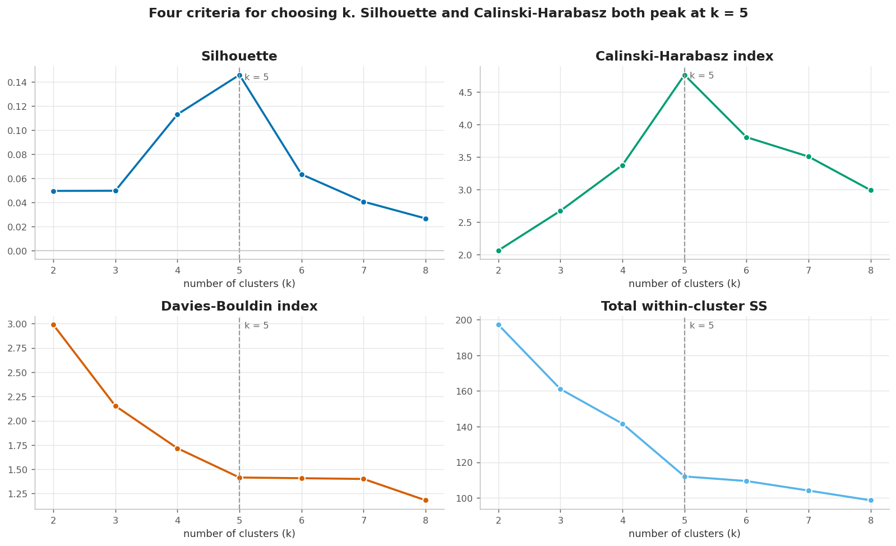

---

## The result

Five segments, each anchored to a real company, selected because two independent internal
validity indices agree on `k = 5`:

| Cluster | n | Medoid | Defining signature |
|---|---|---|---|
| **A** | 5 | Arizona | Cheap fuel, below-average load factor, above-average sales |
| **B** | 4 | Madison | Nuclear-heavy (mean 41.2 against a dataset max of 50.2), lowest fuel cost |
| **C** | 2 | Nevada | Highest sales, fastest demand growth, zero nuclear |
| **D** | 7 | New England | Most expensive fuel, highest load factor, lowest volume |
| **E** | 4 | Southern | Highest rate of return, highest fixed charge, lowest cost |

Silhouette **0.145985** (0.1460 to 4 dp), total within-cluster sum of squares **112.045**.
The segmentation is seed-independent across all nine seeds tested, and survives 200
random-subset refits with mean ARI 0.69.

## Why this project exists

Utility companies differ sharply in how they generate and price power. Some run
nuclear-heavy fleets at near-zero fuel cost; others carry expensive fuel exposure and thin
margins. Averaging them into a single "typical utility" destroys exactly the structure an
analyst needs. This project segments them, then tests how much of the apparent structure is
real — because a clustering that only looks convincing is worse than no clustering at all.

## Objectives

1. **Segment** 22 utility companies by operating profile.
2. **Choose the cluster count from measured evidence**, not convention, and report where
   the evidence disagrees.
3. **Compare** hierarchical clustering against K-Medoids on identical inputs, quantified.
4. **Justify the algorithm choice by measurement** rather than assertion.
5. **Stress-test the result** against seed changes and sample resampling, and report the
   limits honestly.

## Dataset

`data/Utilities.csv` — 22 companies x 8 numeric attributes, delivered with spaced headers
and trailing whitespace in the company names. 0 nulls, 0 duplicate rows.

| Attribute | Mean | Std. dev. | Min | Max |
|---|---|---|---|---|
| `fixed_charge` | 1.114 | 0.185 | 0.75 | 1.49 |
| `ror` | 10.736 | 2.244 | 6.40 | 15.40 |
| `cost` | 168.182 | 41.191 | 96.00 | 252.00 |
| `load_factor` | 56.977 | 4.461 | 49.80 | 67.60 |
| `demand_growth` | 3.241 | 3.118 | −2.20 | 9.20 |
| `sales` | 8914.05 | 3549.98 | 3300.00 | 17441.00 |
| `nuclear` | 12.000 | 16.792 | 0.00 | 50.20 |
| `fuel_cost` | 1.103 | 0.556 | 0.309 | 2.116 |

Two properties of this data drove every downstream decision.

**The feature scales are wildly mismatched.** Decomposing the raw pairwise squared distance
across features shows `sales` alone supplies **99.98%** of it; the other seven attributes
together supply 0.02%. On the raw matrix, Euclidean distance is arithmetically a function of
revenue, and any multivariate result would be a sales ranking wearing a segmentation's
clothes.

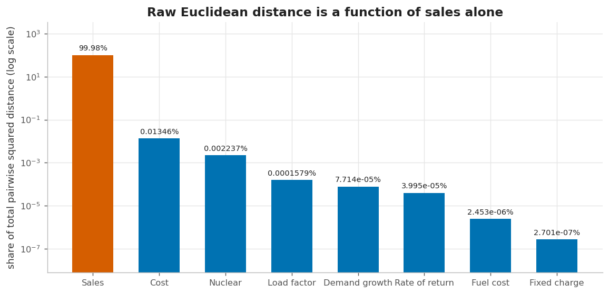

**One attribute is effectively binary.** `nuclear` is exactly zero for 12 of 22 companies
and non-zero for 10; the median is 0 while the mean is 12. It turns out to be the single
strongest separator in the final segmentation.

## Methodology

```
load ─► clean ─► standardise ─► select k ─► cluster ─► evaluate ─► stress-test
                                 ▲                             │
                                 └────── 4 linkage criteria ──┘
```

**1. Clean.** Headers are normalised to `snake_case`, the identifier is stripped and
promoted to the index, features are coerced to float, and null and duplicate rows are
dropped. Every step is counted and reported in `metrics.json` rather than asserted, so it is
visible that cleaning removed nothing here.

**2. Screen for outliers.** Two passes: a sales-versus-fuel-cost scatter, and a formal
nearest-neighbour isolation measure. Median nearest-neighbour distance is 2.03 sd-units and
20 of 22 companies fall within 1.6x that median. The two that do not — **NY (3.69)** and
**Nevada (3.51)** — are the most distinctive operators in the set on this feature space, not
data errors. Nothing is removed.

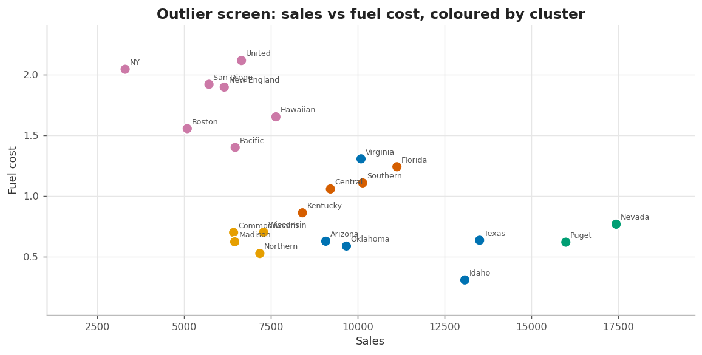
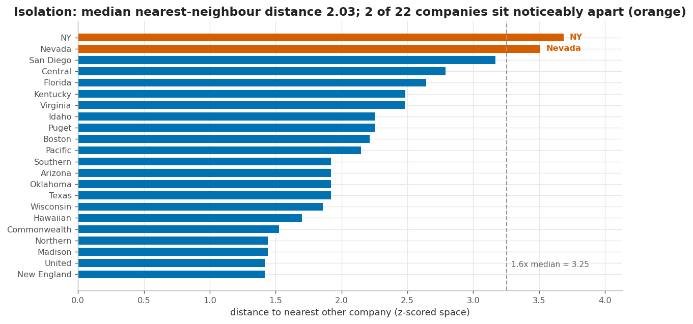

**3. Standardise.** Every attribute is z-scored to zero mean and unit population variance
using `StandardScaler`. Given point 2, this step is what makes the analysis multivariate at
all.

**4. Select the cluster count.** Four criteria are computed for `k = 2..8`, because no single
one is trustworthy on its own.

| k | Silhouette ↑ | Calinski-Harabasz ↑ | Davies-Bouldin ↓ | Total WCSS | Marginal gain | Share below zero |
|---|---|---|---|---|---|---|
| 2 | 0.0495 | 2.07 | 2.99 | 197.15 | — | 31.8% |
| 3 | 0.0496 | 2.67 | 2.15 | 161.06 | 36.09 | 36.4% |
| 4 | 0.1131 | 3.38 | 1.72 | 141.62 | 19.44 | 36.4% |
| **5** | **0.1460** | **4.76** | 1.42 | 112.04 | 29.58 | **22.7%** |
| 6 | 0.0633 | 3.81 | 1.41 | 109.45 | 2.59 | 27.3% |
| 7 | 0.0406 | 3.51 | 1.40 | 104.09 | 5.36 | 31.8% |
| 8 | 0.0266 | 2.99 | 1.18 | 98.64 | 5.45 | 36.4% |

Silhouette and Calinski-Harabasz both peak sharply at `k = 5`. Total within-cluster
dispersion cannot choose `k` at all — it falls monotonically by construction, so the elbow
is read from the *marginal* gain, and the `k = 5 → 6` step buys only 2.59 (2.3%).

Davies-Bouldin dissents, continuing to improve toward `k = 8`. That disagreement is
reported rather than suppressed: Davies-Bouldin assumes convex, spherical clusters, which
is precisely the assumption K-Medoids in 8 dimensions does not guarantee. Majority vote
across the three gives `k = 5`.

**5. Cluster.** Both methods are fitted to the same standardised matrix, making their
outputs directly comparable. Cluster ids are canonicalised by sorting on the
representative's name, because raw estimator labels are arbitrary and would otherwise make
every published result depend on internal ordering.

## Technical approach

### Agglomerative hierarchical clustering

Four linkage criteria, each cut into `k = 5` groups with `fcluster(criterion="maxclust")`.
Cutting a linkage matrix is a real partition; reading a colour threshold off a dendrogram is
not, and its implied grouping changes between SciPy releases.

| Linkage | First merge | Final merge | ARI vs K-Medoids | NMI |
|---|---|---|---|---|
| `single` | 1.4167 | 3.6887 | **0.0296** | 0.3437 |
| `complete` | 1.4167 | 6.6130 | 0.4484 | 0.6641 |
| `average` | 1.4167 | 4.7165 | 0.4484 | 0.6641 |
| `ward` | 1.4167 | 8.1864 | 0.4484 | 0.6641 |

Three findings:

- **`complete`, `average` and `ward` collapse onto one identical partition** (ARI = 1.0
  between every pair). Three independent linkage definitions converging on the same flat
  cut is the strongest corroboration in this analysis.
- **Single linkage is pathological.** It is still merging at 3.69 when the others have
  finished, and its flat cut agrees with K-Medoids at ARI = 0.03 — effectively nothing.
  This is the chaining failure mode, quantified rather than asserted.
- **Agreement with K-Medoids is moderate** (ARI ≈ 0.45). The two methods find broadly
  related structure without agreeing on boundaries, which is expected given the low
  absolute silhouette.

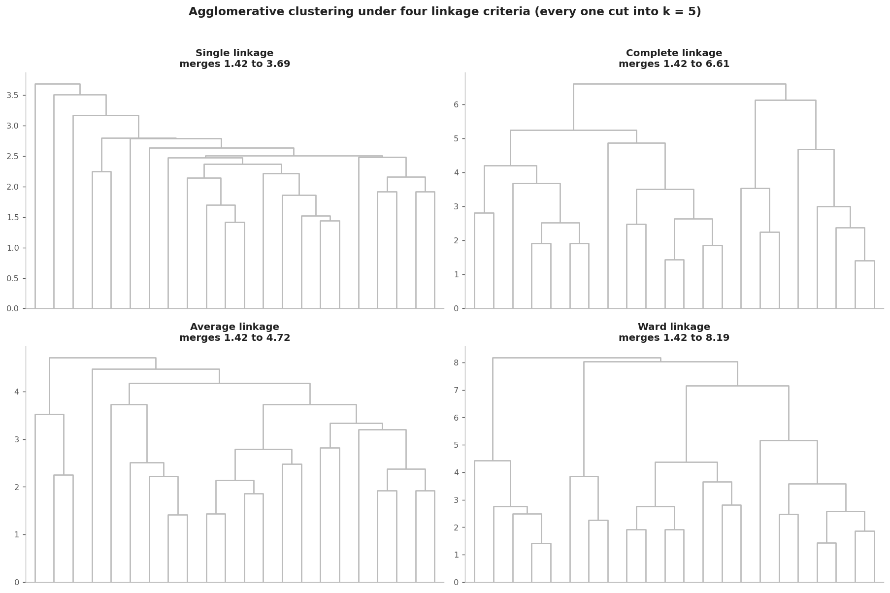
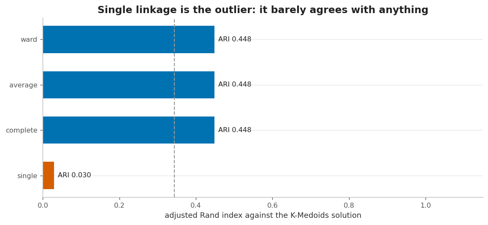

### K-Medoids

`sklearn_extra.cluster.KMedoids`. Chosen over K-Means on two measured grounds rather than
received wisdom:

| Property | K-Medoids | K-Means |
|---|---|---|
| Can a cluster be named? | Yes — centre is a real company | No — centroid is a median 1.55 sd-units from the nearest observation |
| Same result every run? | Yes — min ARI 1.000 across 9 seeds | No — worst seed-to-seed ARI 0.643 |

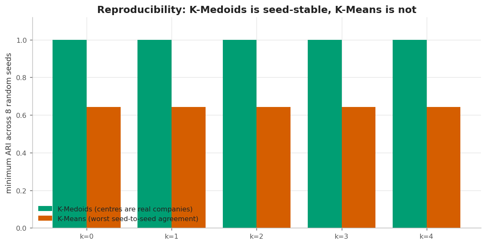

## Results

### Segmentation

| Cluster | n | Members | Medoid | WCSS | Within-cluster signature |
|---|---|---|---|---|---|
| A | 5 | Arizona, Idaho, Oklahoma, Texas, Virginia | Arizona | 25.21 | `fuel_cost` −0.74, `load_factor` −0.69, `sales` +0.61 |
| B | 4 | Commonwealth, Madison, Northern, Wisconsin | Madison | 8.83 | `nuclear` **+1.74**, `fuel_cost` −0.84, `sales` −0.59 |
| C | 2 | Nevada, Puget | Nevada | 12.32 | `sales` **+2.20**, `demand_growth` +1.48, `cost` +1.08 |
| D | 7 | Boston, Hawaiian, NY, New England, Pacific, San Diego, United | New England | 43.20 | `fuel_cost` **+1.25**, `load_factor` +0.80, `sales` −0.86 |
| E | 4 | Central, Florida, Kentucky, Southern | Southern | 22.48 | `ror` **+1.29**, `fixed_charge` +0.93, `cost` −0.79 |

Two axes organise the whole segmentation. **Nuclear participation** separates cluster B
(mean share 41.2%) from every other segment. **Fuel-cost exposure** separates cluster D
(mean 1.80 against a dataset mean of 1.10) from the cheap-fuel clusters A, B and C. Sales
scale then separates C (the high-growth outlier pair) from the rest.

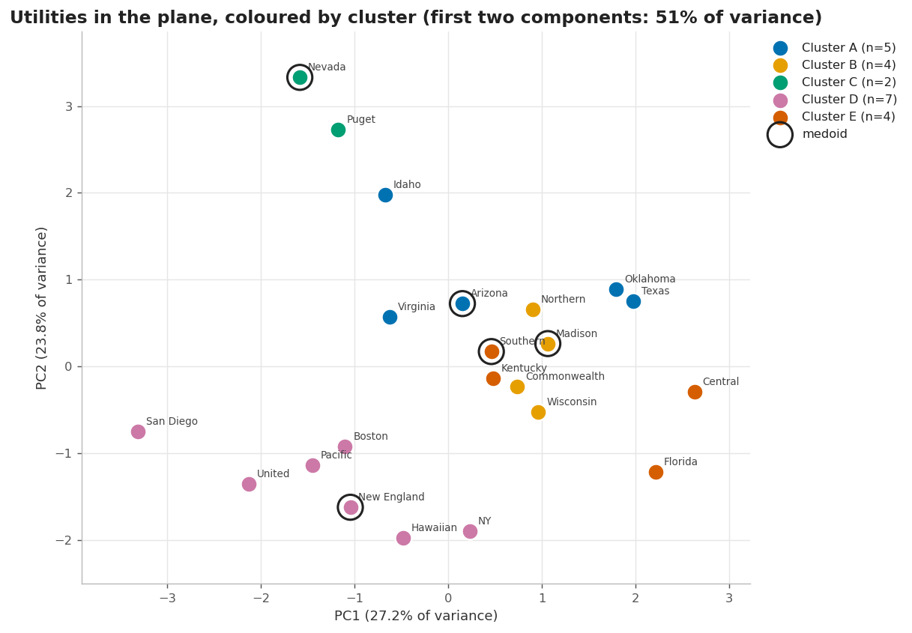

Cluster D carries the most internal dispersion (43.20 across 7 members) and is the clearest
candidate for further splitting.

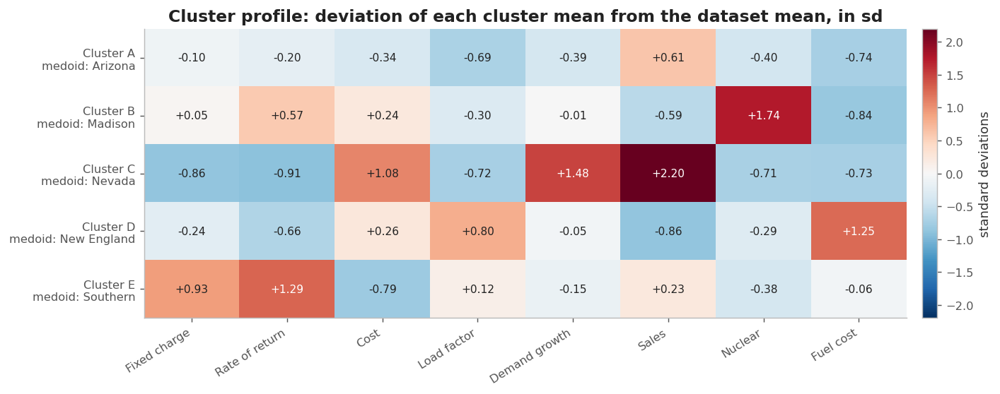

### Sensitivity: why not `k = 6`?

The original submitted report used `k = 6`. It is retained here as a sensitivity check
rather than quietly dropped — the two solutions agree at **ARI 0.82 / NMI 0.89**, so this is
a difference of resolution, not of structure.

The substantive difference: at `k = 6` the algorithm splits the four nuclear-heavy
operators into a 3-member group and a 2-member group with no domain justification. At
`k = 5` they stay together as cluster B. `k = 6` also halves the silhouette (0.063 vs
0.146) and raises the share of companies sitting on the wrong side of their boundary.

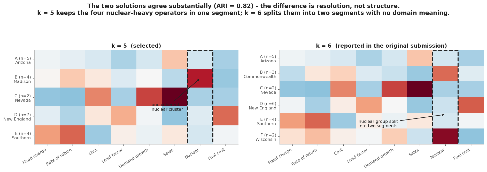

## Robustness

**Seed independence.** K-Medoids returns an identical partition for every seed tested
(min ARI 1.000 across 9 seeds). `random_state` is not load-bearing on this dataset, so the
published segmentation does not rest on a lucky initialisation. K-Means under the same test
manages only 0.643.

**Subsample stability.** Refitting on 200 random subsets is the harshest test available:

| Subsample size | Mean ARI | Median | Share above 0.5 |
|---|---|---|---|
| 16 | 0.532 | 0.550 | 57.0% |
| 18 | 0.615 | 0.622 | 71.0% |
| 20 | 0.693 | 0.751 | 74.5% |

Agreement rises with sample size but stays well short of 1.0. Twenty-two companies is a thin
sample, and the segmentation is correspondingly soft. Per-segment silhouette shows where the
softness actually sits:

| Cluster | n | Mean silhouette | Members closer to another cluster |
|---|---|---|---|
| **B** (Madison) | 4 | **+0.430** | 0 of 4 |
| **D** (New England) | 7 | +0.138 | 1 of 7 |
| **C** (Nevada) | 2 | +0.127 | 0 of 2 |
| **E** (Southern) | 4 | +0.111 | 1 of 4 |
| **A** (Arizona) | 5 | **−0.034** | **3 of 5** |

The nuclear-heavy segment B is by far the cleanest — no member of it is closer to another
cluster than to its own medoid. Cluster A is the weakest: three of its five members sit
closer to a different cluster, which is why the overall silhouette is only 0.146 despite
several genuinely tidy segments. Reporting this is the point — a stability number of 1.0 on
`n = 22` would have been the suspicious result.

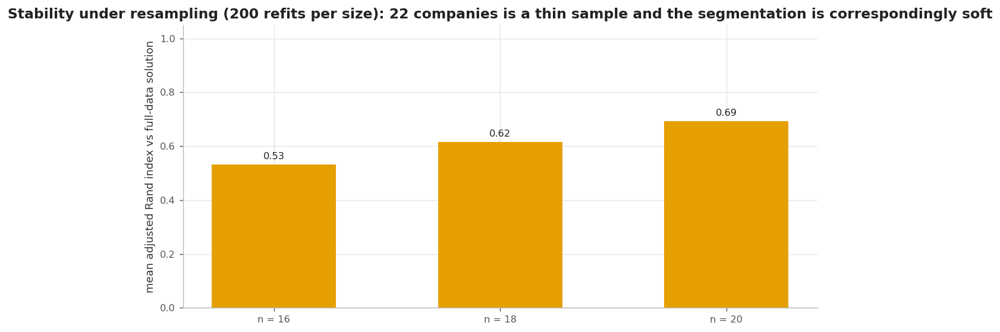

## Key findings

1. **Standardisation is the whole ballgame.** `sales` carries 99.98% of raw pairwise
   distance. Without z-scoring this project would have produced a revenue ranking and
   labelled it a segmentation.
2. **`k = 5` is selected on evidence, and the evidence is reported honestly** — including
   the criterion that dissents.
3. **The algorithm choice is measurable.** K-Medoids gives nameable centres and
   seed-independent results; K-Means gives neither. Neither property is usually claimed
   without a number attached.
4. **Three linkage criteria converging on one partition** (ARI 1.0) is meaningful
   corroboration; single linkage's ARI 0.03 is a quantified demonstration of chaining.
5. **One near-binary attribute does most of the work.** `nuclear` splits 12 companies from
   10 and cleanly isolates cluster B — which is also the tidiest segment in the solution
   (mean silhouette 0.430, no misassigned members).
6. **The segmentation is only as good as its weakest segment.** Cluster A has three of five
   members closer to a different cluster than to its own medoid. Any use of this output
   should treat A as provisional.
7. **Two companies are genuinely distinctive.** NY and Nevada sit further from every other
   operator than any other pair in the space. Cluster C is a two-member segment precisely
   because there is no third company resembling them.
8. **The segments are domain-coherent.** Every cluster has a nameable real-world profile,
   which is the practical test of whether a clustering is worth acting on.

## Limitations

These are material and are not defects to be papered over.

- **Absolute separation is weak.** Silhouette peaks at 0.146, and **22.7% of companies
  (5 of 22) sit closer to another cluster than to their own medoid.** With 8 dimensions and
  22 points this is expected. Treat the segmentation as a reasoning aid, not a deployed
  classifier.
- **n = 22.** Cluster C has two members. For a two-member cluster both members are equally
  valid medoids, so the reported medoid is one of two tied optima.
- **Subsample stability is 0.53–0.69**, not near 1.0. The well-separated segments hold; the
  boundaries between the overlapping ones are an artefact of this particular sample.
- **Davies-Bouldin disagrees with the other two indices** and prefers `k = 8`. The selection
  is a majority vote, not a proof.
- **PCA covers only 50.9% of variance.** The 2-D projection is a rendering of an 8-D
  solution, not the solution itself.
- **The dataset has no documented provenance or units.** Column semantics are inferred from
  names and values only. This is the single largest gap in this work.
- **No held-out evaluation applies.** This is unsupervised analysis over the full dataset.
  There is no predictive model and no generalisation claim.

## Possible future improvements

- Quantify uncertainty directly: bootstrap confidence intervals on cluster profiles rather
  than only on the partition.
- Model selection under a stability-selection framework, aggregating over many resamples
  instead of scoring one solution.
- Compare against model-based clustering (Gaussian mixtures) to test whether these segments
  are real components or an artefact of the distance metric.
- Weight or drop attributes so that `sales` does not dominate even after standardisation,
  and report whether the segmentation survives.
- Source and document the dataset properly, which would make the cluster interpretation
  considerably more useful.

## Technologies

| Tool | Version | Role |
|---|---|---|
| Python | 3.11+ | Runtime |
| NumPy | **< 2** | Arrays; upper bound is load-bearing |
| pandas | any | Data frames, grouping |
| SciPy | any | `linkage`, `fcluster`, `cdist`, hierarchical cut |
| scikit-learn | any | `StandardScaler`, validity indices, `PCA`, `KMeans` |
| scikit-learn-extra | 0.3.0 | `KMedoids` |
| setuptools | **required on 3.12+** | Supplies the `distutils` shim scikit-learn-extra needs |
| Matplotlib | **< 3.9** | All figures |
| Jupyter | any | Notebook |
| pytest / ruff | any | Tests and linting |

Three pins are load-bearing rather than stylistic, and each has a specific failure mode:

- `numpy<2` — scikit-learn-extra 0.3.0 ships Cython extensions compiled against the NumPy
  1.x C API; importing it under NumPy 2 raises `ValueError: numpy.dtype size changed`.
- `matplotlib<3.9` — `matplotlib.cm.get_cmap` was removed in 3.9.
- `setuptools` on Python ≥ 3.12 — scikit-learn-extra 0.3.0 runs
  `from distutils.version import LooseVersion` at import time, and `distutils` left the
  standard library in 3.12 (PEP 632). Without setuptools supplying the shim,
  `from sklearn_extra.cluster import KMedoids` fails with
  `ModuleNotFoundError: No module named 'distutils'`.

  This one was found by CI rather than by local testing: the analysis was developed on
  Python 3.11, where `distutils` is still in the standard library and nothing goes wrong.
  A regression test now asserts the dependency is declared.

## Repository structure

```
.
├── README.md
├── Makefile                    install / run / test / lint / check
├── pyproject.toml              dependencies, packaging, tool config
├── requirements.txt            convenience pointer to the package
├── requirements-dev.txt        dev + notebook extras
├── data/
│   └── Utilities.csv           22 companies x 8 attributes
├── src/utilities_clustering/
│   ├── config.py               paths, constants, palette
│   ├── data.py                 load, clean, quality report, standardise
│   ├── clustering.py           K-Medoids, hierarchical, canonical labelling
│   ├── evaluation.py           dispersion, validity indices, agreement, stability
│   ├── pipeline.py             end-to-end orchestration
│   ├── plotting.py             every figure, one house style
│   └── cli.py                  command-line entry point
├── scripts/
│   ├── run_analysis.py             thin wrapper, works without installing
│   ├── build_notebook.py           regenerates the notebook from reviewable source
│   └── verify_published_metrics.py re-derives every number in this README
├── tests/                      69 tests
│   ├── test_data.py
│   ├── test_clustering.py
│   ├── test_evaluation.py
│   └── test_outputs.py
├── notebooks/
│   └── analysis.ipynb          narrative walkthrough, outputs committed
├── outputs/                    generated, committed for review
│   ├── figures/                15 figures
│   ├── metrics.json            every metric in this README
│   ├── k_selection.csv
│   ├── segmentation.csv
│   ├── segmentation_quality.csv
│   ├── cluster_profiles.csv
│   ├── cluster_profiles_k6.csv
│   ├── linkage_comparison.csv
│   └── stability.csv
├── .github/workflows/ci.yml    tests + published-metric guard, 4 environments
```

## Setup

```bash
git clone <this-repo> utilities-clustering && cd utilities-clustering
python -m venv .venv
source .venv/bin/activate            # Windows: .venv\Scripts\activate
pip install -e ".[dev,notebook]"
```

## Running

```bash
python scripts/run_analysis.py     # regenerate every figure, table and metric
make test                          # 69 tests
make check                         # lint + tests + metric guard, what CI runs
jupyter notebook notebooks/analysis.ipynb
```

Useful flags:

```bash
python scripts/run_analysis.py --k 6          # report a different cluster count
python scripts/run_analysis.py --no-figures   # tables and metrics only
python scripts/run_analysis.py --quick        # reduced resampling, for a fast smoke run
```

To confirm this README has not drifted out of sync with the code:

```bash
python scripts/run_analysis.py && python scripts/verify_published_metrics.py
# OK: all 22 published values reproduce exactly.
```

The notebook is committed with its outputs so results are visible without running
anything. Its *source* lives in `scripts/build_notebook.py`, so the narrative is reviewable
and diffable as plain text rather than opaque JSON:

```bash
python scripts/build_notebook.py --execute     # rebuild from source and re-run
```

## Reproducibility

Every figure, table and number in this README is generated by the pipeline and written to
`outputs/`. Nothing is transcribed by hand, and the notebook imports the same package the
CLI runs, so the two cannot drift apart.

- **Deterministic.** Cluster labels are canonicalised by representative name, so results do
  not depend on estimator internals. Two consecutive runs are identical.
- **Seed-independent.** The published segmentation is unchanged across all nine seeds
  tested; CI asserts this on every push.
- **Byte-reproducible.** Verified from a clean virtualenv built only from
  `pip install -e ".[dev]"` on Python 3.11: all 15 figures and `metrics.json` regenerate
  with identical SHA-256 hashes.
- **Guarded.** `scripts/verify_published_metrics.py` re-derives the 22 values this README
  quotes and exits non-zero if any has moved. It runs in CI, so a dependency upgrade that
  invalidates the write-up fails the build instead of silently making it wrong.

Verified on Python 3.11 with pandas 3.0.6, NumPy 1.26.4, SciPy 1.17.1, scikit-learn
1.9.1, scikit-learn-extra 0.3.0, Matplotlib 3.8.4.